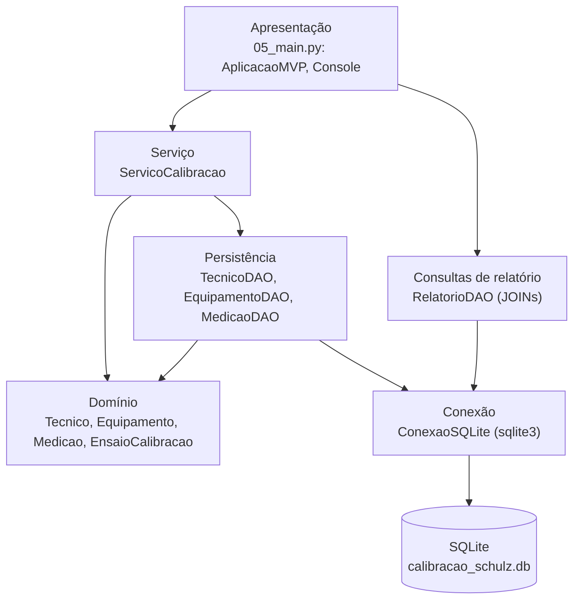
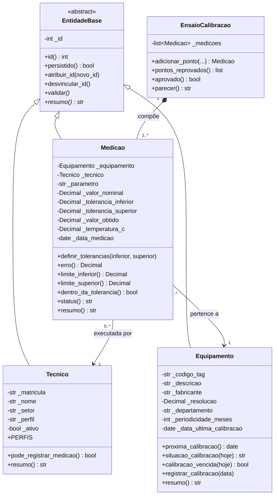
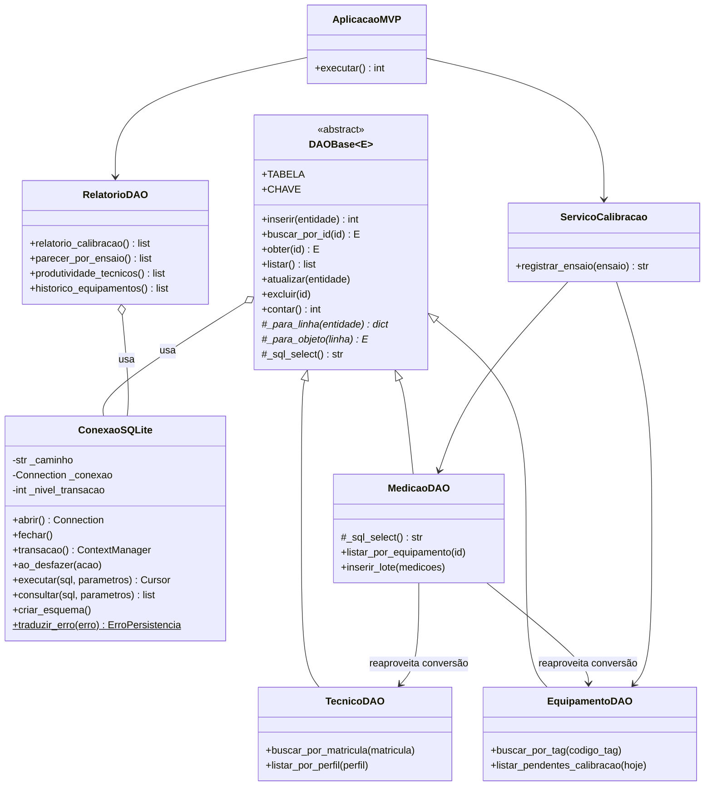
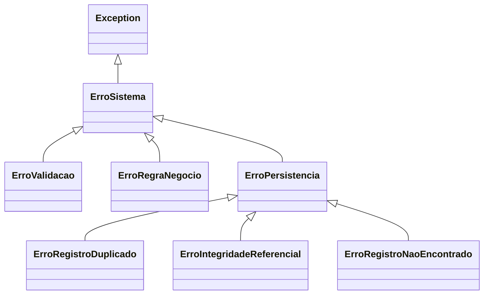
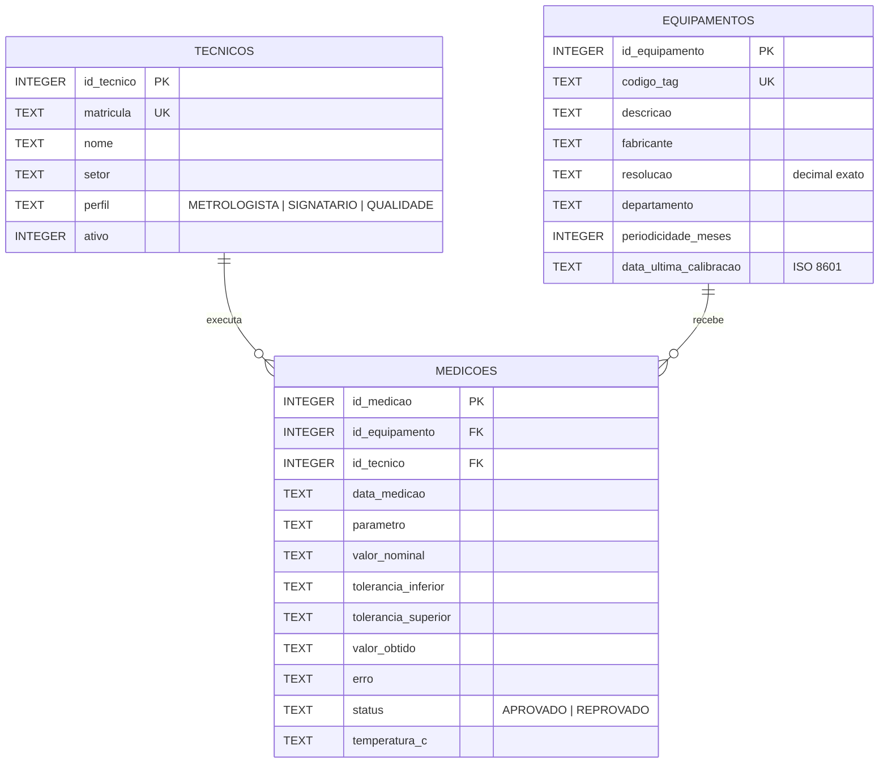

# AV03 - Construção do MVP (Parte 1)

Classes em POO (Python) e persistência em banco SQLite

- Projeto Aplicado I, UniSENAI Florianópolis. Empresa parceira: Schulz S.A.
- Docentes: Prof. MSc. Hugo Menezes Barra e Prof. Rodrigo Losina
- Equipe: Gabriel Oliveira Born, Gustavo Felicio de Lacerda, Iduilton Junior de Souza Santos, Mateus Foltran Tomaz e Mateus Paterno
- Repositório: <https://github.com/GustavoFelicioDeLacerda/projeto-aplicado-schulz>

---

## 1. Objetivo e escopo

Na AV01 levantamos como a Schulz emite hoje os certificados de calibração e definimos os requisitos e as
regras de negócio. Na AV02 modelamos o banco. Nesta etapa o objetivo foi tirar isso do papel: escrever as
classes do sistema em Python, ligar essas classes a um banco SQLite e montar um script que mostra tudo
funcionando no terminal.

O código está no repositório <https://github.com/GustavoFelicioDeLacerda/projeto-aplicado-schulz>, com os
três arquivos pedidos no roteiro:

| Item do roteiro | Arquivo | O que tem dentro |
|---|---|---|
| 1. Classes de domínio e conexão SQL | `04_classes.py` | classes `Tecnico`, `Equipamento` e `Medicao`, a classe de conexão com o SQLite e as classes de acesso a dados (DAO) com `INSERT`, `SELECT`, `UPDATE` e `DELETE` |
| 2. Classe principal de demonstração | `05_main.py` | classe `AplicacaoMVP`, que cria os objetos, grava dados de teste, faz as consultas com `JOIN` e imprime o relatório de calibração |
| 3. Documentação técnica | `06_mvp_parte1.md` | este documento |

Também tem a pasta `tests/`, com 29 testes automatizados que conferem as regras e o acesso ao banco.

Algumas decisões valem para o projeto inteiro:

- Usamos Python 3.10 ou mais novo e só a biblioteca padrão. O `sqlite3` já vem com o Python, então quem baixar o repositório não precisa instalar nada para rodar.
- O banco tem as três tabelas do roteiro: `tecnicos`, `equipamentos` e `medicoes`. Elas são o núcleo do modelo da AV02 (`usuario` virou `tecnicos`, `instrumento` virou `equipamentos` e `medicao` virou `medicoes`). As outras tabelas da AV02 (certificado, padrão de calibração e histórico) ficaram para a Parte 2.
- Quando uma validação vem de uma regra da AV01, o código cita o número dela (RN05, RN10 etc.), com a mesma numeração daquele documento. Assim dá para sair do requisito e chegar na linha de código que o implementa.

## 2. Como executar

```bash
python 05_main.py
python 05_main.py --banco :memory:
python -m unittest discover -s tests -v
```

O primeiro comando apaga e recria o arquivo `calibracao_schulz.db` e mostra as sete etapas da demonstração.
O segundo faz a mesma coisa sem criar arquivo nenhum. O terceiro roda os testes. No VS Code dá para usar o
botão Run com o `05_main.py` aberto, ou digitar os comandos no terminal integrado.

Sobre o nome do arquivo: o roteiro pede `04_classes.py`, mas em Python não dá para escrever
`import 04_classes`, porque nome de módulo não pode começar com número. Para manter o nome pedido, o
`05_main.py` carrega o módulo com `importlib.import_module("04_classes")`.

## 3. Organização do código

```text
projeto-aplicado-schulz/
├── 04_classes.py        # domínio, persistência SQLite e serviço
├── 05_main.py           # classe principal de demonstração
├── 06_mvp_parte1.md     # esta documentação
├── tests/test_mvp.py    # testes automatizados
├── docs/                # PDFs das entregas (AV01, AV02 e AV03)
└── README.md
```

Separamos o código em camadas. Cada camada só usa a que está abaixo dela:



- **Domínio** (`Tecnico`, `Equipamento`, `Medicao`, `EnsaioCalibracao`): guarda os dados e as regras metrológicas. Nessas classes não tem nenhuma linha de SQL.
- **Persistência** (`ConexaoSQLite` e os DAOs): abre a conexão, controla as transações, faz o CRUD e transforma os erros do banco em mensagens que dá para entender.
- **Serviço** (`ServicoCalibracao`): regras que mexem em mais de uma tabela ao mesmo tempo, como registrar um ensaio inteiro.
- **Apresentação** (`AplicacaoMVP` e `Console`, no `05_main.py`): chama as outras camadas e formata a saída. Também não tem SQL nem regra de negócio.

Na prática, isso permite testar a regra de tolerância sem criar banco nenhum, que é o que os testes da
classe `Medicao` fazem.

## 4. Diagramas UML

Os diagramas estão em Mermaid, que é UML escrito em texto. No GitHub eles aparecem desenhados.

### 4.1 Classes de domínio



### 4.2 Persistência, serviço e apresentação



### 4.3 Hierarquia de exceções



### 4.4 Modelo do banco (SQLite)



## 5. Como aplicamos POO em Python

### 5.1 Abstração

`EntidadeBase` e `DAOBase` são classes abstratas (herdam de `ABC`). Não dá para criar um objeto direto
delas: elas servem de molde. Toda entidade é obrigada a implementar `validar()` e `resumo()`, e todo DAO é
obrigado a implementar `_para_linha()` (objeto para colunas do banco) e `_para_objeto()` (linha do banco
para objeto). Se uma classe filha esquecer algum desses métodos, o Python não deixa nem instanciar.

### 5.2 Encapsulamento

Python não tem `private` de verdade, então seguimos a convenção: todo atributo tem sublinhado na frente
(`_nome`, `_valor_obtido`) e é acessado por `@property`. O que faz diferença é o setter, que valida o valor
toda vez, e não só no construtor. Se alguém fizer `tecnico.nome = "X"` com o objeto já criado, dá
`ErroValidacao` e o nome antigo continua lá. Isso aparece na etapa 6.1 da demonstração.

```python
@property
def nome(self) -> str:
    return self._nome

@nome.setter
def nome(self, valor: str) -> None:
    texto = limpar_texto(valor, "Nome do técnico", tamanho_maximo=100)
    if len(texto) < 3 or not self._PADRAO_NOME.match(texto):
        raise ErroValidacao(f"Nome do técnico inválido: '{texto}'.")
    self._nome = texto
```

Outros cuidados com o estado dos objetos:

- O `id` é atribuído uma vez só, pelo banco, e depois não muda.
- O equipamento e o técnico de uma medição não podem ser trocados depois que ela é criada.
- As duas tolerâncias mudam juntas, pelo método `definir_tolerancias()`. Se fossem dois setters separados, trocar a faixa de [-0,01; +0,01] para [+0,02; +0,05] daria erro no meio do caminho: ao mudar só a inferior para +0,02, ela ficaria maior que a superior (+0,01).
- `erro`, os limites e o `status` não têm setter, são calculados na hora. Por isso o status nunca fica desatualizado em relação ao valor medido.

### 5.3 Herança

- `Tecnico`, `Equipamento` e `Medicao` herdam de `EntidadeBase` o controle do ID e o `__str__`/`__repr__`.
- Os três DAOs herdam de `DAOBase`. O `INSERT`, o `SELECT`, o `UPDATE` e o `DELETE` estão escritos uma vez só, na classe mãe. Cada DAO filho só informa a tabela e como converter objeto em linha e linha em objeto. Sem isso, cada DAO teria uma cópia do mesmo bloco de cursor, commit e rollback.
- As exceções também formam uma hierarquia: `ErroSistema` é a mãe de todas e `ErroPersistencia` é a mãe dos erros de banco. Quem chama pode capturar o erro específico (`ErroRegistroDuplicado`) ou o grupo inteiro (`ErroPersistencia`).

### 5.4 Polimorfismo

- `print(objeto)` funciona para qualquer entidade: o `__str__` está na classe mãe e chama `resumo()`, que cada filha implementa do seu jeito. Por isso a etapa 2 imprime técnicos e equipamentos com o mesmo código.
- O `inserir()` da `DAOBase` chama `self._para_linha()` sem saber qual DAO está rodando, e cada um devolve as suas colunas. Esse é o padrão *Template Method*.
- O `MedicaoDAO` sobrescreve só o `_sql_select()`, para trazer o técnico e o equipamento junto com um `JOIN`. Com isso, os métodos herdados (`buscar_por_id`, `listar`, `obter`) passam a devolver medições completas sem precisar reescrever nada.

### 5.5 Associação e composição

- **Associação:** a `Medicao` guarda o objeto `Equipamento` e o objeto `Tecnico`, não só os IDs. No relatório dá para usar direto `medicao.tecnico.nome`.
- **Composição:** o `EnsaioCalibracao` reúne as medições de um equipamento numa data. As medições são criadas pelo próprio ensaio (`adicionar_ponto`), e é ele que calcula o parecer do conjunto.

### 5.6 Padrões de projeto usados

- **DAO:** todo o SQL fica nas classes DAO, longe das regras de negócio.
- **Template Method:** o CRUD da `DAOBase`, completado pelos métodos `_para_linha` e `_para_objeto` de cada filho.
- **Gerenciador de contexto (`with`):** `with ConexaoSQLite(...)` fecha a conexão no final, e `with db.transacao()` faz o `COMMIT` ou o `ROLLBACK` sozinho.
- **Camada de serviço:** o `ServicoCalibracao` concentra a regra de registrar um ensaio, que envolve duas tabelas.

## 6. Regras de negócio no código

### 6.1 Atributos e validações

| Classe (tabela) | Atributos | O que é validado |
|---|---|---|
| `Tecnico` (`tecnicos`) | `id_tecnico`, `matricula`, `nome`, `setor`, `perfil`, `ativo` | matrícula no formato `99999-9` (o mesmo da AV01, ex.: 16858-0) e sem repetir; nome com letras e pelo menos 3 caracteres; perfil METROLOGISTA, SIGNATARIO ou QUALIDADE |
| `Equipamento` (`equipamentos`) | `id_equipamento`, `codigo_tag`, `descricao`, `fabricante`, `modelo`, `numero_serie`, `resolucao`, `unidade`, `departamento`, `periodicidade_meses`, `data_ultima_calibracao`, `ativo` | TAG sem repetir (ex.: 703.1208); resolução maior que 0 e até 1; unidade mm, µm ou pol; periodicidade de 1 a 60 meses; data de calibração que não esteja no futuro |
| `Medicao` (`medicoes`) | `id_medicao`, `equipamento`, `tecnico`, `data_medicao`, `parametro`, `valor_nominal`, `tolerancia_inferior`, `tolerancia_superior`, `valor_obtido`, `temperatura_c`, `observacao`, e os calculados `erro` e `status` | tolerância inferior menor que a superior; temperatura entre 15 e 30 °C (a mesma faixa do CHECK da AV02); data que não esteja no futuro; nome do parâmetro padronizado |

### 6.2 Como a `Medicao` decide entre APROVADO e REPROVADO

A regra é a RN05 da AV01, a soma algébrica. O erro é o valor obtido menos o valor nominal, e o ponto é
aprovado se o valor obtido estiver entre `nominal + tolerância inferior` e `nominal + tolerância superior`,
contando os próprios limites:

```text
erro            = valor_obtido - valor_nominal
limite_inferior = valor_nominal + tolerancia_inferior
limite_superior = valor_nominal + tolerancia_superior
status          = APROVADO se limite_inferior <= valor_obtido <= limite_superior
                  REPROVADO nos outros casos
```

No paquímetro da demonstração, o bloco de 50 mm tem faixa de 49,98 a 50,02. O valor obtido foi 50,02,
exatamente no limite, e o ponto foi aprovado. No bloco de 100 mm a faixa vai de 99,97 a 100,03 e o
paquímetro marcou 100,04. Esse ponto foi reprovado, e por causa dele o ensaio inteiro também foi (RN06).

As tolerâncias podem ser diferentes para cima e para baixo. A posição `13P_POSICAO_1` do dispositivo, por
exemplo, aceita de 0 até +0,050.

Todas as contas usam `Decimal` em vez de `float`. Com `float`, `0.1 + 0.2` dá `0.30000000000000004`, e numa
medida com sete casas, como 6,0787295 mm, esse tipo de diferença pode mudar o resultado justamente quando o
valor está no limite da tolerância.

| Caso (nominal 25,00; tolerância -0,02 / +0,02) | Valor obtido | Erro | Status |
|---|---:|---:|---|
| Dentro da faixa | 25,01 | +0,01 | APROVADO |
| Exatamente no limite superior | 25,02 | +0,02 | APROVADO |
| Acima do limite | 25,0201 | +0,0201 | REPROVADO |
| Abaixo do limite | 24,9799 | -0,0201 | REPROVADO |

### 6.3 Regras da AV01 que estão no código

| Regra (AV01) | O que diz | Onde está |
|---|---|---|
| RN02 | Vencimento = última calibração + periodicidade; alertar antes de vencer (o UC05 fala em 15 dias) | `Equipamento.proxima_calibracao()`, `situacao_calibracao()`, `EquipamentoDAO.listar_pendentes_calibracao()` |
| RN05 | Aceitação por soma algébrica na faixa [nominal + tol. inf.; nominal + tol. sup.] | `Medicao.erro`, `dentro_da_tolerancia()`, `status` |
| RN06 | Se algum parâmetro for reprovado, o ensaio é reprovado e o equipamento não é liberado | `EnsaioCalibracao.parecer`; o `ServicoCalibracao` só atualiza a data de calibração quando o ensaio é aprovado |
| RN10 | Só metrologista ativo registra resultados de medição | `Tecnico.pode_registrar_medicao()`, conferido em `ServicoCalibracao.registrar_ensaio()` |
| Seção 3.1 (nulos) | Valores como "------", "00/00/0000" e "Não informado" viram nulo | `limpar_texto()`, `para_data()` |
| Seção 3.1 (números) | "20,4°" vira 20.4; vírgula decimal vira ponto | `para_decimal()` |
| Seção 3.1 (nomes) | "62P_DIÂMETRO 1" vira "62P_DIAMETRO_1"; parâmetro sem número de ponto recebe o prefixo "REF_" | `normalizar_parametro()` |
| Seção 3.1 (duplicidade) | Chave instrumento + data + parâmetro | `UNIQUE (id_equipamento, data_medicao, parametro)` na tabela `medicoes` |

## 7. Persistência no SQLite

### 7.1 A classe de conexão

A `ConexaoSQLite` cuida da conexão `sqlite3`. Os pontos mais importantes:

- No SQLite as chaves estrangeiras vêm **desligadas** por padrão. Sem rodar `PRAGMA foreign_keys = ON` em toda conexão, o banco aceitaria uma medição apontando para um equipamento que não existe. A classe liga isso assim que abre a conexão, e a etapa 1 da demonstração mostra o PRAGMA ligado.
- As transações são explícitas (`BEGIN`, `COMMIT` e `ROLLBACK`), pelo `with db.transacao()`. Uma transação pode ficar dentro da outra, e só a de fora confirma. É isso que faz o registro de um ensaio ser tudo ou nada: se um ponto falhar, os pontos anteriores do mesmo ensaio também são desfeitos.
- Quando acontece um `ROLLBACK`, os objetos que já tinham recebido ID voltam a ficar sem ID, para a memória não ficar diferente do banco. Na saída da etapa 6.3 aparece `ID do 1º ponto após o ROLLBACK: None`.
- Com `row_factory = sqlite3.Row` as colunas são lidas pelo nome (`linha["codigo_tag"]`), e não pela posição.
- O esquema é criado por `criar_esquema()`, com `CREATE TABLE IF NOT EXISTS`.

### 7.2 Onde está cada operação do CRUD

| Operação | Métodos | SQL |
|---|---|---|
| INSERT | `inserir(entidade)`, `inserir_lote(medicoes)` | `INSERT INTO <tabela> (...) VALUES (:coluna, ...)` |
| SELECT | `buscar_por_id`, `obter`, `listar`, `buscar_por_tag`, `buscar_por_matricula`, `listar_por_perfil`, `listar_por_equipamento` | `SELECT ... WHERE ... = ?` (com `JOIN` no `MedicaoDAO`) |
| UPDATE | `atualizar(entidade)` | `UPDATE <tabela> SET coluna = :coluna ... WHERE <chave> = :_id` |
| DELETE | `excluir(id)` | `DELETE FROM <tabela> WHERE <chave> = ?` |

### 7.3 Como tratamos os dados no banco

- **Números:** o SQLite não tem tipo `DECIMAL`, e o `REAL` é ponto flutuante. Por isso os valores das medições são gravados como texto (`"6.0787295"`) e convertidos para `Decimal` no DAO. Quando uma consulta precisa fazer conta, como o maior erro do relatório 7.2, usamos `CAST(erro AS REAL)` só ali.
- **Datas:** também são texto, no formato `AAAA-MM-DD`, com um `CHECK (date(x) = x)` que recusa data malformada.
- **Valores de lista fixa:** `perfil`, `status`, `unidade` e `ativo` têm `CHECK`. Mesmo que alguém rode um SQL direto no banco, um status "TALVEZ" não entra (etapa 6.2).
- **Vínculos:** as chaves estrangeiras usam `ON DELETE RESTRICT`, então não dá para apagar um técnico ou equipamento que tenha medições.
- **Duplicidade:** `UNIQUE` em `matricula`, em `codigo_tag` e na chave de deduplicação da AV01 (equipamento + data + parâmetro).
- **Erro e status gravados:** ficam salvos para os relatórios em SQL e são comparados com o recálculo toda vez que a medição é lida. Se alguém mexer no valor direto no banco, a leitura acusa (etapa 6.3).
- **SQL Injection:** os valores sempre vão como parâmetro (`?` ou `:nome`), nunca colados no texto do SQL. Nomes de tabela e coluna vêm de constantes do próprio código.

O trecho abaixo é a tabela de medições (o esquema completo está em `ConexaoSQLite.ESQUEMA_SQL`):

```sql
CREATE TABLE IF NOT EXISTS medicoes (
    id_medicao           INTEGER PRIMARY KEY AUTOINCREMENT,
    id_equipamento       INTEGER NOT NULL REFERENCES equipamentos (id_equipamento)
                         ON UPDATE CASCADE ON DELETE RESTRICT,
    id_tecnico           INTEGER NOT NULL REFERENCES tecnicos (id_tecnico)
                         ON UPDATE CASCADE ON DELETE RESTRICT,
    data_medicao         TEXT    NOT NULL CHECK (date(data_medicao) = data_medicao),
    parametro            TEXT    NOT NULL,
    valor_nominal        TEXT    NOT NULL,
    tolerancia_inferior  TEXT    NOT NULL,
    tolerancia_superior  TEXT    NOT NULL,
    valor_obtido         TEXT    NOT NULL,
    erro                 TEXT    NOT NULL,
    status               TEXT    NOT NULL CHECK (status IN ('APROVADO', 'REPROVADO')),
    temperatura_c        TEXT    NOT NULL,
    observacao           TEXT,
    criado_em            TEXT    NOT NULL DEFAULT (datetime('now', 'localtime')),
    UNIQUE (id_equipamento, data_medicao, parametro)
);
```

## 8. Tratamento de erros SQL

Toda exceção do `sqlite3` é capturada na camada de persistência. Antes de repassar o erro, a transação
sofre `ROLLBACK`, e o método `ConexaoSQLite.traduzir_erro()` troca a exceção do banco por uma exceção do
sistema com uma mensagem que dá para entender. A exceção original não se perde: ela fica guardada
(`raise ... from erro`) para quem precisar investigar.

| Situação | Erro do sqlite3 | Exceção do sistema | Mensagem que aparece |
|---|---|---|---|
| Matrícula ou TAG repetida | `IntegrityError: UNIQUE constraint failed` | `ErroRegistroDuplicado` | "Já existe registro com o mesmo valor em tecnicos.matricula." |
| Apagar equipamento que tem medições | `IntegrityError: FOREIGN KEY constraint failed` | `ErroIntegridadeReferencial` | "Operação bloqueada pela integridade referencial..." |
| Medição de um equipamento que não existe | `IntegrityError: FOREIGN KEY constraint failed` | `ErroIntegridadeReferencial` | a mesma |
| Valor fora da lista gravado por SQL direto | `IntegrityError: CHECK constraint failed` | `ErroPersistencia` | "Valor rejeitado pela restrição CHECK do banco (status IN (...))." |
| Campo obrigatório vazio | `IntegrityError: NOT NULL constraint failed` | `ErroPersistencia` | "Campo obrigatório não informado: ..." |
| Arquivo bloqueado ou tabela inexistente | `OperationalError` | `ErroPersistencia` | "Falha operacional no SQLite: ..." |
| UPDATE ou DELETE de um ID que não existe | (nenhuma linha afetada) | `ErroRegistroNaoEncontrado` | "tecnicos: ID 9999 não encontrado." |
| Dado alterado por fora do sistema | (percebido na leitura) | `ErroPersistencia` | "Medição 4: erro/status gravados divergem do recálculo..." |

Os erros de dados inválidos nem chegam ao banco: são barrados antes, nas próprias classes, com
`ErroValidacao` (valor inválido) ou `ErroRegraNegocio` (por exemplo, a RN10). No `05_main.py`, cada cenário
de erro é tratado separadamente, e no nível mais alto o `main()` captura `ErroSistema` para encerrar com
uma mensagem clara em vez de um traceback.

## 9. Como testamos

### 9.1 O que a demonstração faz

O `python 05_main.py` passa por sete etapas, cada uma ligada a um pedido do roteiro:

1. Conecta ao SQLite, cria as tabelas e mostra que o `PRAGMA foreign_keys` está ligado.
2. Cria 4 técnicos e 4 equipamentos em memória e mostra a situação de calibração de cada equipamento, ainda sem gravar nada.
3. Grava os cadastros (`INSERT`) e mostra o ID que o banco gerou para cada um.
4. Registra 3 ensaios com 10 medições ao todo: dois aprovados e um reprovado (o paquímetro, com um ponto fora da tolerância).
5. Lê de volta do banco (`SELECT` por TAG, com `JOIN` e com filtro), altera um técnico e um equipamento (`UPDATE`) e apaga um cadastro (`DELETE`).
6. Força 13 situações de erro, entre erros de validação e erros do banco, e mostra cada uma sendo tratada.
7. Imprime o relatório de calibração e mais três relatórios com `INNER JOIN`, `LEFT JOIN` e `GROUP BY`.

### 9.2 Execução no VS Code

Rodamos o `05_main.py` pelo botão Run do VS Code em 06/11/2026, três vezes seguidas, e também o
`04_classes.py` sozinho. A saída completa da primeira execução está no Apêndice A do PDF. O que deu para
ver nessas execuções:

- As três terminaram com `exited with code=0` e com `13/13` cenários de erro tratados.
- Os IDs começam sempre do 1, porque o script apaga e recria o banco no começo. Isso foi feito para a demonstração dar sempre o mesmo resultado, não importa quantas vezes ela rode.
- Rodar o `04_classes.py` sozinho não mostra nada e termina com código 0. É o esperado: esse arquivo só define as classes. Quem usa as classes é o `05_main.py` e os testes.
- Os dados de teste usam datas contadas a partir do dia da execução. Comparando com uma execução anterior, de 03/11, todas as datas andaram três dias (a última calibração do dispositivo 703.1208 passou de 25/08 para 28/08), mas as situações (VENCIDA, A VENCER, EM DIA) e os pareceres continuaram iguais.

Trecho do relatório de calibração dessa execução (etapa 7.1):

```text
  ------------------------------------------------------------------------------------------------
  EQUIPAMENTO PAQ-150-014 - Paquímetro digital 0-150 mm
  Departamento: Fundição               Data: 05/11/2026   Temperatura: 19.8 °C
  Executado por: Carla Mendes Ribeiro (matrícula 17024-3)   Unidade: mm
  ------------------------------------------------------------------------------------------------
  PARÂMETRO        NOMINAL  TOL. INF  TOL. SUP  OBTIDO   ERRO  STATUS
  ---------------  -------  --------  --------  ------  -----  ---------
  1P_BLOCO_25_MM     25.00     -0.02     +0.02   25.01  +0.01  APROVADO
  2P_BLOCO_50_MM     50.00     -0.02     +0.02   50.02  +0.02  APROVADO
  3P_BLOCO_100_MM   100.00     -0.03     +0.03  100.04  +0.04  REPROVADO
  PARECER DO ENSAIO: REPROVADO (2/3 pontos dentro da tolerância)
```

Como o paquímetro foi reprovado, ele não foi liberado: a data da última calibração continuou a antiga e ele
aparece no alerta de vencimento (etapa 7.4):

```text
  TAG          DEPARTAMENTO  MEDIÇÕES  ÚLT. MEDIÇÃO  PRÓX. CALIBRAÇÃO  SITUAÇÃO
  -----------  ------------  --------  ------------  ----------------  --------------
  703.1208     Usinagem I           4  06/11/2026    06/01/2027        EM DIA
  MIC-025-007  Compressores         3  09/07/2026    09/07/2027        EM DIA
  PAQ-150-014  Fundição             3  05/11/2026    16/11/2026        A VENCER
  REL-010-003  Montagem             0  -             -                 SEM CALIBRACAO

  [ALERTA] REL-010-003 (Montagem): SEM CALIBRACAO - nunca calibrado
  [ALERTA] PAQ-150-014 (Fundição): A VENCER - vence em 10 dia(s)
```

No relatório de produção por técnico (etapa 7.3) usamos `LEFT JOIN` de propósito: assim os técnicos com
perfil SIGNATARIO e QUALIDADE aparecem na lista mesmo sem nenhuma medição. Com `INNER JOIN` eles sumiriam.

```text
  MATRÍCULA  NOME                    PERFIL        MEDIÇÕES  EQUIP.  APROV.  REPROV.
  ---------  ----------------------  ------------  --------  ------  ------  -------
  17024-3    Carla Mendes Ribeiro    METROLOGISTA         7       2       6        1
  17110-8    Rafael Antunes Weber    METROLOGISTA         3       1       3        0
  15530-1    Helena Cristina Duarte  SIGNATARIO           0       0       0        0
  18002-5    Marcos Vinícius Prado   QUALIDADE            0       0       0        0
```

### 9.3 Testes automatizados

O comando `python -m unittest discover -s tests -v` roda 29 testes, e todos passaram (resultado no
Apêndice B do PDF). Eles estão divididos assim:

| Grupo | Testes | O que confere |
|---|---:|---|
| `TestSaneamento` | 5 | regras de limpeza de dados da AV01: decimal com vírgula e "°", valores-sentinela, nomes de parâmetro e soma de meses no fim do mês |
| `TestMedicao` | 9 | erro por soma algébrica, limites que contam como aprovados, reprovação acima e abaixo, tolerância diferente para cima e para baixo, recálculo do status e parecer do ensaio |
| `TestEncapsulamento` | 4 | setters que validam depois da criação, ID que não muda, RN10 e situação de calibração |
| `TestPersistenciaSQLite` | 10 | chave estrangeira ligada, gravar e ler sem perder casas decimais, UPDATE e DELETE, UNIQUE, RESTRICT, ID inexistente, lote tudo ou nada, CHECK, RN06 e RN10 no serviço |
| `TestDemonstracao` | 1 | roda o `05_main.py` inteiro em memória e confere os 13 cenários e os pareceres |

### 9.4 Conferência com o roteiro

| O roteiro pede | Onde está |
|---|---|
| POO em Java ou Python | Python, com abstração, encapsulamento, herança, polimorfismo e composição (seção 5) |
| Classe `Tecnico` com `id_tecnico`, `matricula`, `nome`, `setor`... | `Tecnico`, com esses atributos e mais `perfil` e `ativo` |
| Classe `Equipamento` com `id_equipamento`, `codigo_tag`, `descricao`, `fabricante`... | `Equipamento`, com esses atributos e mais resolução, departamento e periodicidade |
| Classe `Medicao` com status `APROVADO`/`REPROVADO` pelas tolerâncias e pelo valor obtido | `Medicao.status` e `dentro_da_tolerancia()` (seção 6.2) |
| Classe de conexão e persistência com `INSERT`, `SELECT` e `UPDATE` via `sqlite3` | `ConexaoSQLite` e os DAOs, que também fazem `DELETE` (seção 7) |
| `05_main.py` com objetos, registros de teste, `JOIN` e relatório no terminal | etapas 2 a 7 da demonstração (seção 9.1) |
| Documentação com padrões de POO, UML, erros SQL e validação do fluxo | seções 4, 5, 8 e 9 |
| Repositório no GitHub | <https://github.com/GustavoFelicioDeLacerda/projeto-aplicado-schulz> |

## 10. O que ficou para a Parte 2

Esta parte cobre as três entidades do roteiro. Ainda não estão no código o padrão de calibração, o
certificado com numeração sequencial (RN08), a assinatura do signatário (RN04) e o histórico de eventos.
A conferência de erro e status na leitura percebe quando alguém altera o banco por fora, mas não impede que
isso aconteça. E o SQLite atende bem um laboratório com poucas pessoas usando ao mesmo tempo; com muitos
acessos simultâneos seria melhor um banco em servidor, como o MySQL da AV02.

Para a Parte 2, a ideia é incluir as tabelas `padrao_calibracao`, `certificado` e `historico_evento` da AV02
como novas filhas de `EntidadeBase` e `DAOBase`, importar o relatório da MMC (Calypso) direto para um
`EnsaioCalibracao`, gerar o certificado em PDF com numeração automática e fazer a tela do sistema por cima
do `ServicoCalibracao`, sem precisar mexer nas classes de domínio.
